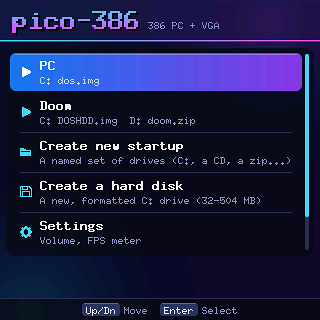
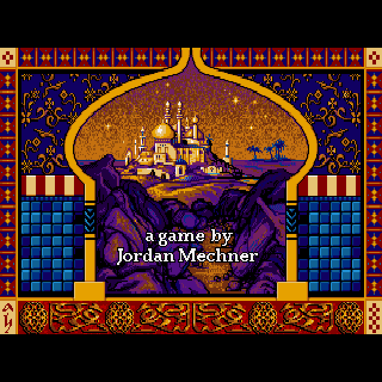
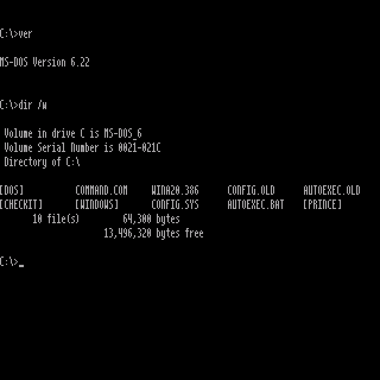
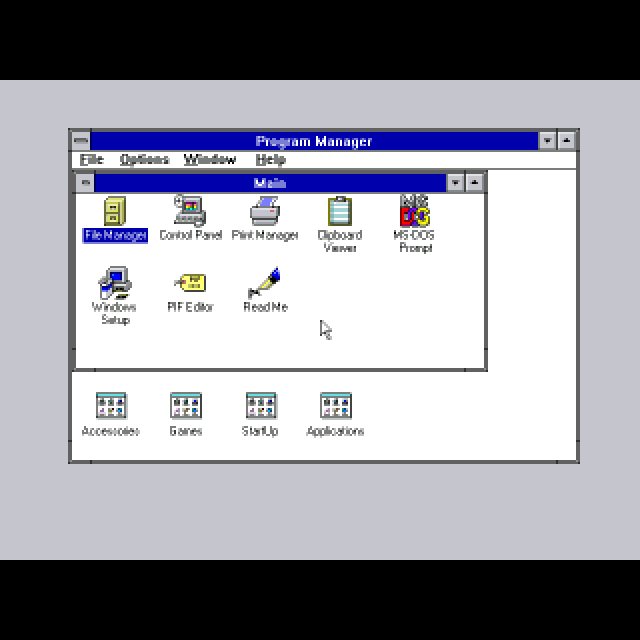
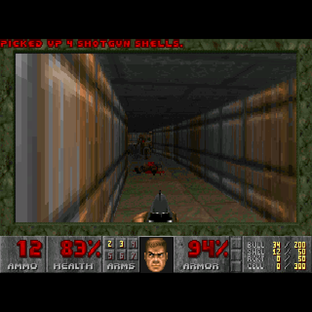
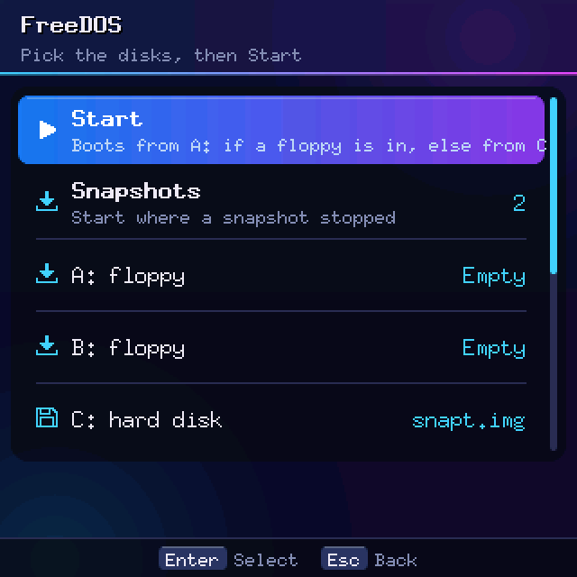
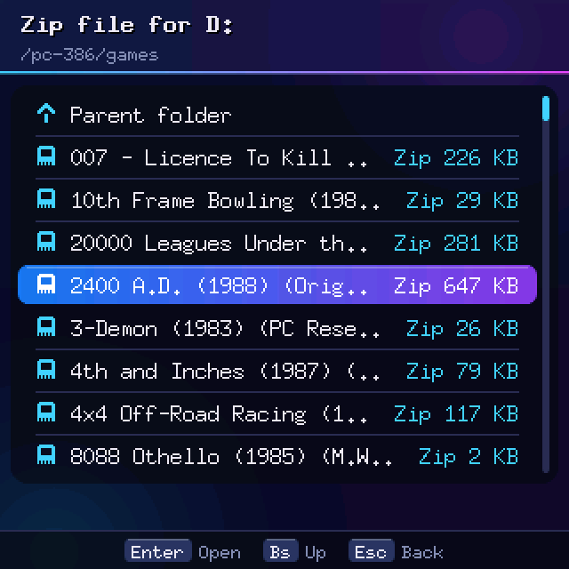
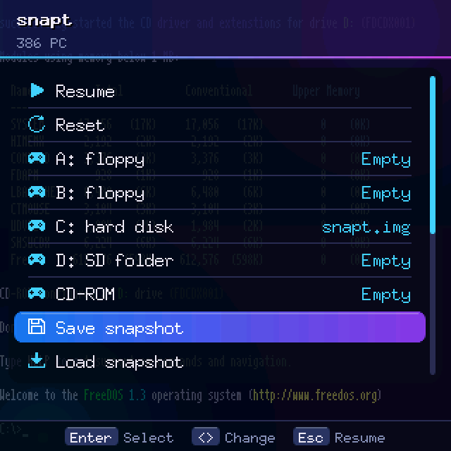

# pico-386

A 386 PC for the **ClockworkPi PicoCalc**: DOS, Windows 3.x, VGA, Sound Blaster 16, Adlib and
the PC speaker, on the PicoCalc's own screen and keyboard. It runs on two modules:

- a **Waveshare ESP32-P4-WIFI6**, the faster one, with up to 32 MB of guest RAM
- a plain **Raspberry Pi Pico 2** (RP2350), with 4 MB of guest RAM paged from the mainboard's PSRAM

The same code also builds for the desktop (SDL2), for debugging. The emulator is
[tiny386](https://github.com/hchunhui/tiny386). The menus and the hardware layer come from the
author's pico-amiga and [emu8](https://github.com/hexadevti/emu8).

<p>








</p>

The screenshots come from the desktop build, which draws the same 320x320 picture as the
PicoCalc.

## What it does

- **The PC:** a 386 with an FPU, SeaBIOS, a VGA card (with VBE modes on the P4), IDE hard
  disks, a CD-ROM drive, two floppy drives, a PS/2 keyboard and mouse, a
  Sound Blaster 16, an Adlib and the PC speaker.
- **Disks from the SD card:** raw hard-disk and floppy images, `.iso` CDs, and also a plain folder
  or a `.zip` as a drive, so a game zip can be played without making an image.
- **Disk swaps while the PC runs**, for multi-disk installers and games.
- **Startups:** named sets of drives in the home menu, one for each thing you run.
- **Screen:** text mode is drawn in a hand-made 4x12 font that stays readable on 320 pixels.
  Graphics are scaled to 320x240: 320x200 is stretched, and 640x480 is averaged 2:1.
- **A mouse from the keyboard:** the arrows can move a PS/2 mouse pointer, for Windows and mouse games.

**What runs:** MS-DOS 6.22 and FreeDOS 1.3, Windows 3.11, and DOS games. On the P4, CheckIt rates
the PC at about 9x a PC-XT (2 MIPS), which is a slow 386: Prince of Persia and most 1980s-1990
games play well, and Doom runs but slowly. The RP2350 rates about 5x a PC-XT (1.1 MIPS) and slows
down further when a program uses more memory than its 64 KB of fast RAM holds.

| | ESP32-P4 | Pico 2 (RP2350) |
|---|---|---|
| CPU | 386 + FPU | 386 + FPU |
| Guest RAM | as much as fits, up to 32 MB | 4 MB, paged from the mainboard's 8 MB PSRAM |
| Video RAM | 1 MB (SVGA/VBE) | 160 KB (VGA up to 640x480x16) |
| Speed (CheckIt) | about 9x PC-XT | about 5x PC-XT |
| Sound | 44.1 kHz, I2S | 22 kHz, PWM |

## Installing

Download the files from the [releases page](https://github.com/hexadevti/pico-386/releases):

| File | For |
|---|---|
| `pico-386-pml-vX.Y.Z.zip` | [PicoMultiLoader](https://github.com/hexadevti/PicoMultiLoader), both modules |
| `pico-386-rp2350-vX.Y.Z.uf2` | a Pico 2 (RP2350) |
| `pico-386-p4-vX.Y.Z.bin` | an ESP32-P4: the app alone, for a loader |
| `pico-386-p4-merged-vX.Y.Z.bin` | an ESP32-P4: the whole flash image, for esptool |

- **PicoMultiLoader:** unzip the `pml` zip into the root of the SD card. It makes a `pico-386/`
  folder holding both builds, and the loader picks the one for your module. PC-386 then shows
  on the loader's Home screen.
- **Pico 2 without a loader:** hold **BOOTSEL** while plugging in USB, then copy the `.uf2` onto
  the `RP2350` drive. This replaces any loader you had.
- **ESP32-P4 without a loader:** write the merged image at offset 0 with
  `esptool.py --chip esp32p4 write_flash 0x0 pico-386-p4-merged-vX.Y.Z.bin`. This also replaces
  any loader.

**Ctrl-Shift-Up** in the menus, or **Ctrl-PgUp** while the PC runs, goes back to the loader.

## The SD card

The card must be FAT32. Everything pico-386 uses lives in one folder, `/pc-386`. We recommend
this layout, so the BIOS is found without any setting, the PC startup finds its hard disk, and
the file browser opens where your files are:

```
/pc-386/
├── roms/
│   ├── bios.bin          SeaBIOS     } required: the PC does not start without them
│   └── vgabios.bin       SeaVGABIOS  }
├── c.img                 the hard disk the PC startup boots (C:)
├── disks/                floppy, hard-disk and CD images (.img, .ima, .vhd, .iso)
├── games/                game .zip files and folders, to use as D: or as a floppy
└── share/                a folder to swap files with your computer, used as D:
```

The easy way to get there: copy the repo's [`sdcard/pc-386/`](sdcard/) folder to the card's
root. It already has `roms/`, and `disks/` with the FreeDOS 1.3 install floppies, a FreeDOS hard
disk, empty hard-disk and floppy images, a CD driver floppy and some tests.
[`sdcard/README.md`](sdcard/README.md) says what each one is. Then unzip
`disks/freedos-hdd-128mb.zip`, rename the image `c.img` and put it in `/pc-386/`, and the PC
startup boots FreeDOS. `games/` and `share/` are yours to make.

A few rules keep things working:

- **Keep the BIOS in `/pc-386/roms/`.** Firmware v0.1.0 looked in `/roms/pc/`; it is still
  checked, so either works. **Settings > BIOS folder** can point anywhere else.
- **Name your hard disk `c.img`**, or pick another image as C: on the startup's drives screen.
- **Keep file and folder names short.** The card is FAT32 and zips are unpacked under
  `/pc-386/.unzipped/`. Very long names are shortened, but short ones are easier to find in
  the browser.
- **Don't touch the files pico-386 writes:**

```
/pc-386/pc.ini           the PC startup, written with defaults the first time
/pc-386/startN.ini       the startups made with "Create new startup"
/pc-386/pico386.cfg      the frontend settings (volume, FPS meter, font size, last startup)
/pc-386/.unzipped/       zips unpacked for use as drives, and what the PC saved in them
/pc-386/.pico386-dN.tmp  a D: folder's pending writes while the PC runs
```

If you use PicoMultiLoader, the app itself is in `/pico-386/` (with a dash). It is a separate
folder from `/pc-386/`, which holds the data: keep both.

Disk images are raw. A hard disk is a flat sector dump (a `.vhd` must be a *fixed* VHD), and a
floppy is 160 KB to 2.88 MB. Guest writes go straight to the image on the card.

The two BIOS files can live in another folder. **Settings > BIOS folder** opens a file browser:
pick `bios.bin` there (the row says `OK` when `vgabios.bin` is next to it). Every startup uses
that folder.

MS-DOS, Windows and games are not included; use your own copies.

## Using it

The home menu lists the **startups**. The first, **PC**, uses `c.img` as C: (or `dos.img` or
`win.img` if there is no `c.img`). The P4's PC asks for 32 MB of RAM and steps down 4 MB at a
time until it fits. The CPU type only changes what programs detect, not the speed.

**Drives.** Choosing a startup opens its drives screen first:

| Row | What it does |
|---|---|
| **Start** | Turns the PC on. It boots from A: if a floppy is in, otherwise from C:. |
| **A: floppy**, **B: floppy** | Put in a floppy image, a folder or a `.zip`, or eject it. |
| **C: hard disk** | Pick the hard-disk image. |
| **D: SD folder** | Pick a folder or a `.zip` on the SD card. The PC sees it as drive D:. |
| **CD-ROM** | Put in an `.iso`, or eject it. |
| **Boot from** | C:, or the CD before C:. |
| **Rename**, **Delete** | Rename the startup, or delete it (every one but PC). |

The file browser shows only files that fit the drive, and labels each one with its type and
size: "Floppy 1.44 MB", "Hard disk 128 MB", "CD 650 MB", "Zip 226 KB". Typing letters jumps to
the names that start with them.

**D: is a folder or a zip on the card.** It's the easy way to get files in and out of the PC.
Put programs or games in a folder from your computer, then pick that folder as D:.

- DOS sees the folder's files and subfolders as an ordinary hard disk. Windows 95 also sees their
  long names.
- What the PC changes on D: (new, edited, renamed or deleted files) is saved into the folder
  **when you turn the PC off** with Quit machine in the in-game menu, or when you change C: or D:.
  "Saving" shows while it writes. If the PicoCalc loses power first, those changes are lost.
- A zip is unpacked once to `/pc-386/.unzipped/`. The PC then runs from that copy, and its
  writes go there, never into the zip.
- Files DOS creates get DOS names (`NEW.TXT`). Files that were already there keep their names.
- If no C: is set, the folder is C: instead.
- Formatting or repartitioning D: is never written back, so it cannot wipe the folder.
- The disk is sized for the folder plus 32 MB free, up to 2 GB. Above 504 MB, plain MS-DOS
  can't read it; FreeDOS and Windows 95 can.
- `/pc-386` itself can't be D:, since it holds the PC's own disks.

**A: and B: take a folder or a zip too**, as a 1.44 MB floppy. Unlike D:, it can be swapped
while DOS runs, so you can go through a folder of game zips without restarting the PC.

- A zip that holds floppy images (`.ima`, `.img`, `.vfd`), such as a game's disk set, puts the
  images themselves in the drive. You pick the disk, and the drive's row then offers **Change
  disk**, with the next disk already selected.
- A folder or zip holding more than 1.44 MB is refused ("Too big for a floppy (use D:)").
- What the PC writes on the floppy is saved to its folder when you eject it, swap it, or turn
  the PC off. "Saving A:" shows while it writes.
- The same folder can't be in two drives at once.

**While it runs**, the in-game menu (**Ctrl-Esc**) has the same drive rows:

- **A:, B: and the CD** change immediately, like swapping a real disk, and DOS sees the new disk.
  This is how you feed a multi-disk installer.
- **C: and D:** restart the PC with the new disk, as a real PC would need.

**Create a hard disk** (home menu) makes a new, empty, formatted C: drive:

1. Pick a size: 32, 64, 128, 256 or 504 MB.
2. Pick a file: `c.img` or a new `diskN.img`.

The disk comes out partitioned and formatted (FAT16). Until DOS is installed on it, it shows
"This hard disk has no DOS yet". To install DOS, put a DOS install floppy in A:, then Start.

**Create new startup** asks for a name and opens the new startup's drives screen. Deleting a
startup removes only its `.ini`; the disk images stay.

**Everything is remembered.** The drives, the keyboard mouse's mode and buttons, and the
settings are saved to the startup as you change them, whether on the drives screen or in-game.
So the startup comes back the same way next time. A floppy left in A: boots again, as on a real
PC; eject it to boot from C:.

**Settings** has the volume, the FPS meter, the font size for 80x25 text (4x12, which fills the
screen, or 4x8) and the BIOS folder. The FPS line also shows the PC's speed in MIPS (millions of
instructions per second). It reads low while DOS sits idle at a prompt.

### Keys

Every key goes to the PC except these:

| Keys | What they do |
|---|---|
| **Ctrl-Esc** | the in-game menu: Resume, Reset, the drives, the arrows' mode, the mouse buttons, Ctrl+Alt+Del, Quit machine |
| **Both Shifts together**, or **Ctrl-Tab** | the next mode for the arrows (see below) |
| **Ctrl+Alt+Del**, **Ctrl+Alt+Backspace** | restart the PC |
| **Ctrl-PgUp** (in the PC), **Ctrl-Shift-Up** (in the menus) | back to the loader |
| **Ctrl-F8** (in the PC), **Ctrl-Shift-F3** (in the menus) | restart the PicoCalc |

The arrows have three modes. The current one shows for 2 s under the picture when it changes:

- **Arrows:** arrow keys, as normal.
- **Mouse:** the arrows move the mouse pointer, speeding up while held, and the button keys click.
- **Both:** the arrows move the pointer and are also sent as arrow keys.

In Mouse and Both, the button keys (Alt and Right Shift, unless changed in the in-game menu)
are only mouse buttons. DOS needs a mouse driver (CTMOUSE); Windows has its own.

Shifted characters are sent as Shift plus the US-layout key, so set the PC to the US keyboard
layout. Keys repeat like a real keyboard (500 ms, then 30 a second). **Caps Lock** works on
letters; the PC's own Caps Lock stays off.

### The .ini files

A startup is a tiny386 `.ini` file. Every key tiny386 knows works in it (`fda`, `fdb`,
`hda`..`hdd`, `cda`..`cdd`, `mem_size`, `vga_mem_size`, `[cpu] gen`/`fpu`), and paths are
relative to the card root. Our keys are under `[pico]`:

- `name`: the name in the home menu
- `boot = cd`: try the CD before C:
- `mouse`: the arrows' mode (0 arrows, 1 mouse, 2 both)
- `mouse_left`, `mouse_right`: the button keys (`alt`, `rshift`, `lshift`, `ctrl`, `space`,
  `enter`, `tab`, `bs`, `z`, `x` or `none`)

## Making a disk image

A FreeDOS hard disk, all on the PicoCalc:

1. **Create a hard disk**: 128 MB, `c.img`.
2. **PC**: set A: to `disks/freedos/x86BOOT.img` (FreeDOS 1.3 FloppyEdition, in the repo's
   `sdcard/`). Then Start.
3. Answer the installer. When it asks for the next diskette, press Ctrl-Esc, set A: to
   `x86DSK01.img` (then 02, 03…), and press a key. Wait for each prompt: a disk takes a minute or
   more to read.
4. At the end, eject A: and restart. It boots from C:.

Or prepare an image on a PC with QEMU (`-hda c.img`) and copy it to the card.

**More free memory for games.** DOS games that need 560 KB or more want DOS loaded high. Add
`DOS=HIGH` to `C:\CONFIG.SYS` (with `DEVICE=C:\DOS\HIMEM.SYS` before it).

**A CD-ROM in DOS** needs a driver. Under MS-DOS, put a CD driver such as FreeDOS's `UDVD2.SYS`
in `C:\DOS`, add `DEVICE=C:\DOS\UDVD2.SYS /D:CDROM1 /UX` to `CONFIG.SYS`, and add
`C:\DOS\MSCDEX.EXE /D:CDROM1 /L:E` to `AUTOEXEC.BAT`, ahead of SMARTDRV.

## Building

**ESP32-P4.** Run the VS Code task **P4: Build** or **P4: Build & Upload** (COM9). It uses the
same Arduino-ESP32 3.x install as emu8, emu16 and pico-amiga (`~/.emu6502-p4`).

**RP2350.** Run the task **RP2350: Build** or **RP2350: Build & Upload** (COM7). It uses
[arduino-pico](https://github.com/earlephilhower/arduino-pico) 6.1.1 from the default
arduino-cli folder, with FreeRTOS at 300 MHz, and writes `build-rp2350/pico386.ino.uf2`.

**A release.** `tools/pml-app/package.ps1 -Version X.Y.Z` builds both firmwares and writes
`build-pml/pico-386/` and the PicoMultiLoader zip.

**Desktop.** You need MSYS2 MinGW32 with SDL2 and CMake. Run the task **desktop: build**, or:

```sh
cmake -G "Unix Makefiles" -S . -B build -DCMAKE_BUILD_TYPE=Debug && make -C build -j8
```

`-DEMU_LOWMEM=ON` (in `build-lowmem`) simulates the RP2350's memory: 4 MB of guest RAM paged
through 64 KB. The repo's `sdcard/` folder plays the SD card. The test hooks `PC_INI`,
`PC_KEYS`, `PC_SHOT`, `PC_WAV` and `PC_SD` are described in `CLAUDE.md`.

## Layout

```
pico386/pico386.ino       setup()/loop() -> src/frontend/app.cpp
pico386/board.h           pins, screen geometry and memory model (P4, RP2350, desktop)
pico386/core.h            the interface the emulator core implements
pico386/src/hal/          hal.h, picocalc/ (ESP32-P4), picocalc_rp2350/ (Pico 2), desktop/ (SDL2)
pico386/src/frontend/     menus, file browser, settings, game loop
pico386/src/pc/           the PC: glue, keyboard, screen, startups, folder and zip disks, paging
pico386/src/pc/tiny386/   the vendored emulator (see THIRD_PARTY.md)
tools/                    font generator, PicoMultiLoader packaging, device remote control
docs/screenshots/         the pictures above
sdcard/                   a ready SD card: the BIOS, FreeDOS, empty disks and tests
```

## Third-party code

| Part | Origin | License |
|---|---|---|
| The PC emulator (CPU, chipset, VGA, IDE, SB16, Adlib, speaker) | [tiny386](https://github.com/hchunhui/tiny386) by Chunhui He, with device models from QEMU | BSD-3-Clause, MIT |
| The OPL2 emulator (Adlib) | MAME's fmopl by Tatsuyuki Satoh, via DOSBox, QEMU and tiny386 | LGPL-2.1-or-later |
| The .ini parser | [inih](https://github.com/benhoyt/inih) by Ben Hoyt | BSD-3-Clause |
| The UI fonts | X11 misc-fixed, via FabGL and emu8 | public domain |
| SeaBIOS and SeaVGABIOS (`sdcard/pc-386/roms/`, not in the firmware) | the tiny386 release | LGPL-3.0 |
| FreeDOS 1.3 and UDVD2.SYS (`sdcard/pc-386/disks/`) | [freedos.org](https://www.freedos.org/) | GPL and other free licenses |

`THIRD_PARTY.md` has the details, and lists every change made to tiny386.

## License

GPL-2.0-or-later for this project's own code (see `LICENSE`).
